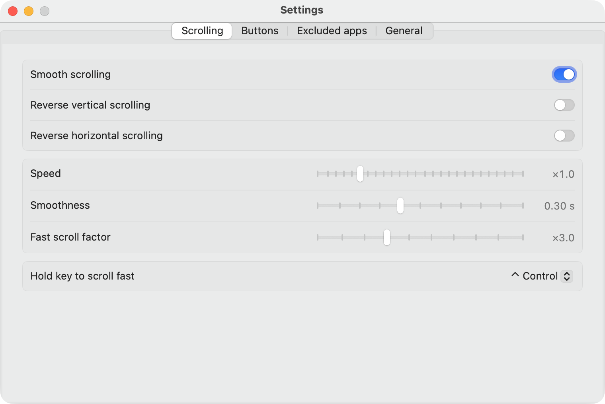
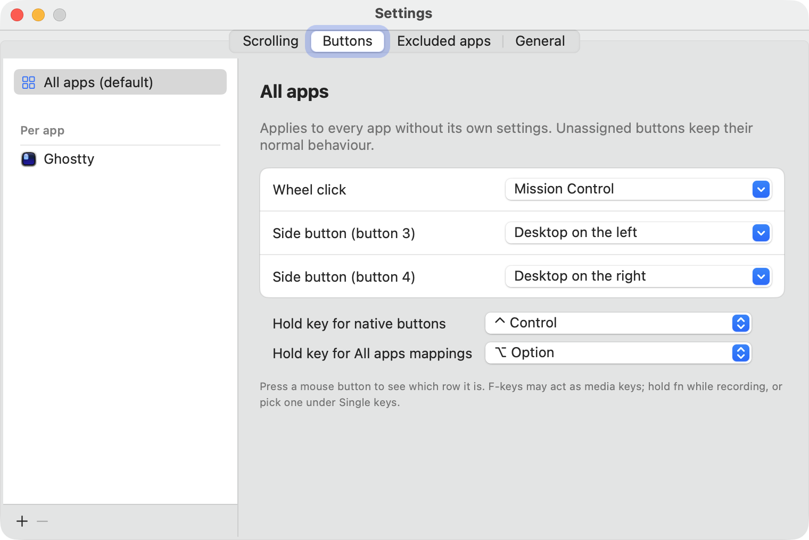
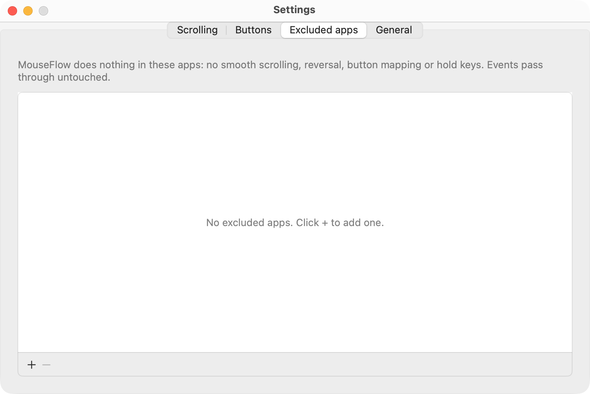

<p align="center">
  
</p>

<h1 align="center">MouseFlow</h1>

<p align="center">A lightweight macOS menu bar app for smooth wheel scrolling and per-app mouse button mapping.</p>

## Features

- **Smooth scrolling** for notched mouse wheels, with adjustable speed and smoothness.
- **Reverse scroll direction** for the mouse only, separately for vertical and horizontal scrolling, so the trackpad
  keeps natural scrolling.
- **Fast scroll**: hold a modifier key (⌥ Option by default) to multiply the scroll distance by an adjustable factor.
- **Per-app button mapping**: assign the middle button and side buttons (buttons 2–4) to a keyboard shortcut or a
  system action (Show Desktop, switch Space, Mission Control, App Windows), either for every app or per app.
- **Excluded apps**: pick apps where MouseFlow does nothing at all, for scrolling and buttons alike.
- **Native button bypass**: hold a modifier key (⌃ Control by default) while clicking to skip the mapping and get the
  button's original behaviour, e.g. Back/Forward in Chrome.
- **All apps override**: hold another modifier key (⌥ Option by default) while clicking to use the All apps mappings
  instead of the current app's own.
- **English and Vietnamese UI**: chosen on first launch, switchable any time from the menu or Settings.
- **Settings window** with Scrolling, Buttons, Excluded apps and General tabs; the menu keeps only the everyday toggles.
- **Launch at login** from the menu or Settings.
- Close to zero CPU when idle.

## Screenshots

| Scrolling | Buttons |
| --- | --- |
|  |  |
| **Excluded apps** | **Menu bar** |
|  |  |

## Requirements

macOS 14 Sonoma or later, on Apple silicon or Intel.

## Install

1. **Download** `MouseFlow-<version>.dmg` from the
   [latest release](https://github.com/quocmanhit/mouse-flow/releases/latest).
2. **Open the disk image** and drag **MouseFlow** onto the **Applications** shortcut next to it.
3. **Open MouseFlow** from Applications. The app is not notarized, so the first time macOS says it can't be opened.
   Go to **System Settings → Privacy & Security**, scroll down and click **Open Anyway**, then confirm. Alternatively,
   clear the quarantine flag in Terminal and open it normally:

   ```bash
   xattr -dr com.apple.quarantine /Applications/MouseFlow.app
   ```

4. **Pick a language.** The first launch asks for English or Tiếng Việt. You can change it later under
   **Language / Ngôn ngữ** in the menu.

   

5. **Grant Accessibility access.** macOS asks for it right after; otherwise open **System Settings → Privacy &
   Security → Accessibility** and turn **MouseFlow** on. MouseFlow starts working as soon as access is granted, with no
   relaunch needed. Until then the menu shows *Grant Accessibility permission…*.
6. **Set it up** from the mouse icon in the menu bar: open **Settings…** (⌘,) to tune scrolling, map buttons and
   exclude apps, and turn on **Launch at login** if you want it to start with macOS.

### Update

Quit MouseFlow from its menu, then drag the new version into Applications and replace the old one. Settings are kept.

### Uninstall

1. Quit MouseFlow from its menu and move `/Applications/MouseFlow.app` to the Trash.
2. Remove it from **System Settings → Privacy & Security → Accessibility**.
3. Optionally delete its settings: `defaults delete com.quocmanh.mouseflow`

## Button mapping tips

- An app's own mapping wins over the "every app" mapping. Choose "Keep native behaviour" in an app to opt it out of a
  global mapping. To switch MouseFlow off for an app entirely, add it under **Excluded apps**.
- Shortcuts are sent to the frontmost app.
- If a button is already bound to a system shortcut (for example Mission Control in System Settings → Keyboard
  Shortcuts), unbind it there first, because macOS handles those before MouseFlow sees the click.
- Mouse software such as Logi Options+ or Razer Synapse that remaps buttons to keystrokes takes precedence, since
  MouseFlow only sees mouse button events.

## Known limitations

- Don't run MouseFlow together with Mos or another smooth-scrolling app: both event taps compete for the same wheel
  events.
- Excluded apps are matched by bundle ID of the app that receives the scroll, or for clicks the app under the pointer
  or the frontmost app; helper processes with their own
  bundle ID are not covered by their parent app's entry.
- Mappings apply to every connected mouse; MouseFlow can't tell devices apart.

## Build from source

Requires Xcode Command Line Tools (Swift 5.10+).

```bash
git clone https://github.com/quocmanhit/mouse-flow.git
cd mouse-flow
make run
```

`make run` builds the app, installs it to `~/Applications` and launches it. It is signed with the `Apple Development`
identity so the Accessibility permission survives rebuilds; without one, use `make run SIGN_ID=-` and grant the
permission again after each build.

- `make dist` packages a universal app into `build/MouseFlow-<version>.dmg`, using the version in
  `Resources/Info.plist`.
- `open ~/Applications/MouseFlow.app --args --trial` runs a build for 60 seconds and then quits, so a broken build
  can't leave the mouse stuck.

See [docs/how-it-works.md](docs/how-it-works.md) for how scrolling and button mapping are implemented.

## License

[MIT](LICENSE) © 2026 Quốc Mạnh
