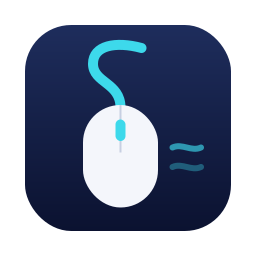
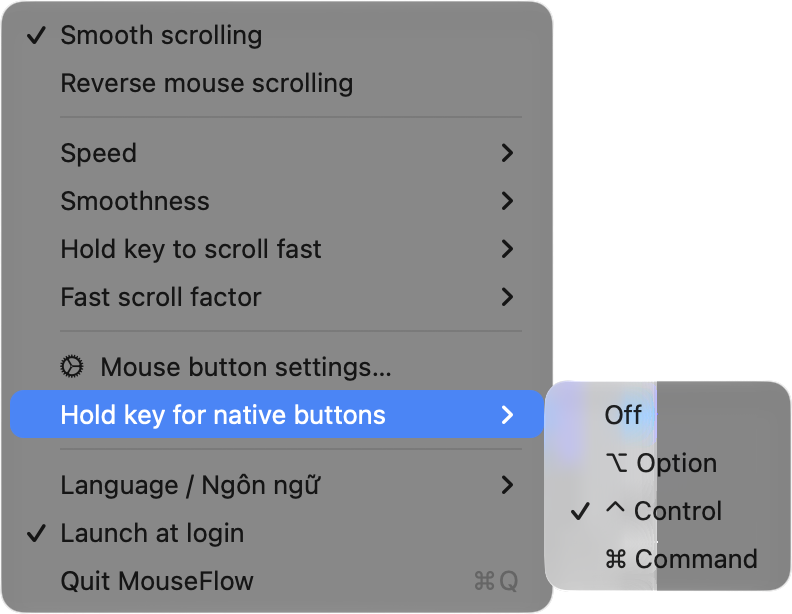
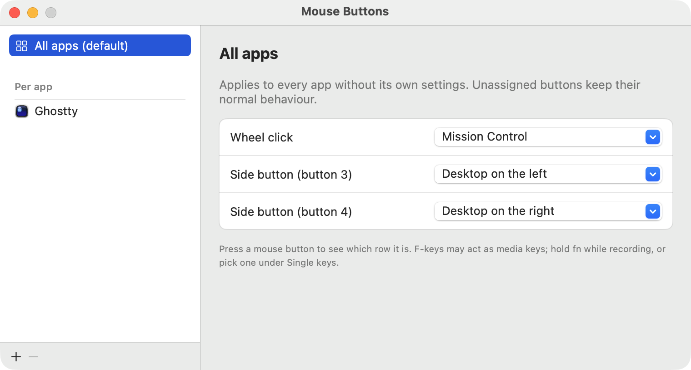
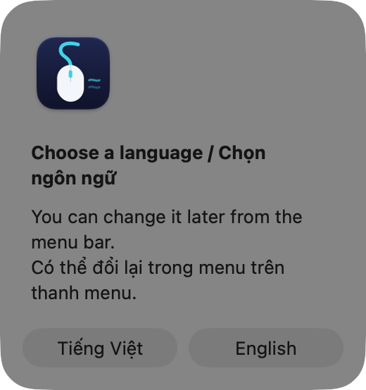

<p align="center">
  
</p>

<h1 align="center">MouseFlow</h1>

<p align="center">A lightweight macOS menu bar app for smooth wheel scrolling and per-app mouse button mapping.</p>

MouseFlow makes a regular notched-wheel mouse feel like a trackpad: scrolling glides smoothly, the scroll direction
can be reversed for the mouse alone, and the middle and side buttons can trigger different shortcuts in each app.
Trackpads and Magic Mouse are left untouched.

## Features

- **Smooth scrolling** for notched mouse wheels, with adjustable speed and smoothness.
- **Reverse scroll direction** for the mouse only, so the trackpad keeps natural scrolling.
- **Fast scroll**: hold a modifier key (⌥ Option by default) to multiply the scroll distance by ×2, ×3 or ×5.
- **Per-app button mapping**: assign the middle button and side buttons (buttons 2–4) to a keyboard shortcut or a
  system action (Show Desktop, switch Space, Mission Control, App Windows), either for every app or per app.
- **Native button bypass**: hold a modifier key (⌃ Control by default) while clicking to skip the mapping and get the
  button's original behaviour, e.g. Back/Forward in Chrome.
- **English and Vietnamese UI**: chosen on first launch, switchable any time from the menu.
- **Launch at login** from the menu.
- Close to zero CPU when idle.

## Screenshots

<p align="center">
  
</p>

<p align="center">
  
</p>

## Requirements

- macOS 14 Sonoma or later, on Apple silicon or Intel
- To build from source: Xcode Command Line Tools (Swift 5.10+)

## Install

1. **Download** `MouseFlow-<version>.dmg` from the
   [latest release](https://github.com/quocmanhit/mouse-flow/releases/latest).
2. **Open the disk image** and drag **MouseFlow** onto the **Applications** shortcut next to it.
3. **Open MouseFlow** from Applications. The app is not notarized, so the first time macOS says it can't be opened.
   Go to **System Settings → Privacy & Security**, scroll down and click **Open Anyway**, then confirm. Alternatively,
   clear the quarantine flag in Terminal and open it normally:

   ```bash
   xattr -dr com.apple.quarantine /Applications/MouseFlow.app
   ```

4. **Pick a language.** The first launch asks for English or Tiếng Việt. You can change it later under
   **Language / Ngôn ngữ** in the menu.

   

5. **Grant Accessibility access.** macOS asks for it right after; otherwise open **System Settings → Privacy &
   Security → Accessibility** and turn **MouseFlow** on. MouseFlow starts working as soon as access is granted, with no
   relaunch needed. Until then the menu shows *Grant Accessibility permission…*.
6. **Set it up** from the mouse icon in the menu bar: adjust scrolling, open **Mouse button settings…** to map
   buttons, and turn on **Launch at login** if you want it to start with macOS.

### Update

Quit MouseFlow from its menu, then drag the new version into Applications and replace the old one. Settings are kept.

### Uninstall

1. Quit MouseFlow from its menu and move `/Applications/MouseFlow.app` to the Trash.
2. Remove it from **System Settings → Privacy & Security → Accessibility**.
3. Optionally delete its settings: `defaults delete com.quocmanh.mouseflow`

## Build from source

```bash
git clone git@github.com:quocmanhit/mouse-flow.git
cd mouse-flow
make run
```

`make run` builds a release binary, packages it as `MouseFlow.app`, signs it, installs it to `~/Applications` and
launches it.

The app is signed with the `Apple Development` identity by default so the Accessibility permission survives
rebuilds. Without that identity, use an ad-hoc signature (you will need to grant the permission again after every
build):

```bash
make run SIGN_ID=-
```

Other targets: `make build`, `make app`, `make install`, `make clean`.

### Package a disk image

```bash
make dist
```

Builds the arm64 and x86_64 slices, merges them with `lipo`, signs the app and writes `build/MouseFlow-<version>.dmg`
with an Applications shortcut for drag-and-drop install. The version comes from `CFBundleShortVersionString` in
`Resources/Info.plist`.


### Trial run

```bash
open ~/Applications/MouseFlow.app --args --trial
```

Runs for 60 seconds and then quits, which is handy for testing a new build without risking a stuck mouse.

## Usage

Click the mouse icon in the menu bar:

| Menu item | What it does |
| --- | --- |
| Smooth scrolling | Turn smooth scrolling on or off |
| Reverse mouse scrolling | Reverse the wheel direction for the mouse only |
| Speed / Smoothness | Scroll distance per notch and glide duration |
| Hold key to scroll fast / Fast scroll factor | Modifier key and multiplier for fast scrolling |
| Mouse button settings… | Map buttons for every app or for specific apps |
| Hold key for native buttons | Modifier key that bypasses button mappings |
| Language / Ngôn ngữ | Switch between English and Vietnamese |
| Launch at login | Start MouseFlow with macOS |

### Button mapping notes

- An app's own mapping wins over the "every app" mapping. Choose "Keep native behaviour" in an app to opt it out of a
  global mapping.
- Shortcuts are sent to the frontmost app.
- If a button is already bound to a system shortcut (for example Mission Control in System Settings → Keyboard
  Shortcuts), unbind it there first, because macOS handles those before MouseFlow sees the click.
- Mouse software such as Logi Options+ or Razer Synapse that remaps buttons to keystrokes takes precedence, since
  MouseFlow only sees mouse button events.

## How it works

- `ScrollEngine` installs a `CGEventTap` at the annotated session level, after the system has picked the target app.
  Continuous events (trackpad, Magic Mouse) pass through unchanged. Line-based wheel events are swallowed, their
  distance is accumulated and then replayed frame by frame on a `CADisplayLink` with an ease-out curve.
- Each frame is a copy of the original event posted directly to the target app with `postToPid`. Posting back into the
  session tap, or into an earlier tap before the event has a target, never reaches the app.
- The fast-scroll modifier is removed from the posted events so apps don't treat them as Option+scroll.
- `ButtonMapper` taps `otherMouseDown/Dragged/Up`. When the frontmost app (or "every app") has a mapping for the
  button, the click is swallowed and the shortcut is sent instead; otherwise the click passes through. When the bypass
  modifier is held, the click passes through with that modifier removed.
- The display link pauses when there is nothing to scroll, so the app stays idle.
- Settings and button mappings are stored in `UserDefaults`.

## Known limitations

- Don't run MouseFlow together with Mos or another smooth-scrolling app: both event taps compete for the same wheel
  events.
- Mappings apply to every connected mouse; MouseFlow can't tell devices apart.
- Only buttons 2–4 (middle, back, forward) can be mapped.

## Project layout

```
Sources/MouseFlow/
  AppDelegate.swift     menu bar item and menu
  ScrollEngine.swift    smooth scrolling event tap
  ButtonMapper.swift    mouse button event tap
  Mappings.swift        shortcuts, system actions and mapping store
  Settings.swift        scroll and modifier settings
  SettingsWindow.swift  button mapping window (SwiftUI)
  KeyRecorder.swift     shortcut recorder
  Localization.swift    English / Vietnamese strings
Resources/Info.plist
docs/images/            README screenshots
MouseFlow-Logo/         app icon (.icns, PNG, SVG) and menu bar template icon
```
